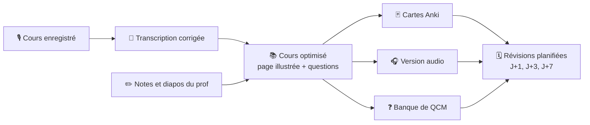

### Bonjour 👋

Étudiant en **1re année de médecine**, passionné par **l'intelligence artificielle** et par la façon dont elle peut aider à apprendre mieux, plus vite et sans s'épuiser.

J'utilise Claude (le chat et Claude Code) comme assistant d'études au quotidien :

- 📚 **Cours optimisés** : à partir de l'enregistrement du cours, de mes notes et des diapos, Claude fait une page claire, illustrée, avec des questions pour se tester ;
- 🃏 **Cartes Anki** créées automatiquement après chaque cours ;
- 🎧 **Version audio** de chaque cours, pour réviser en marchant ;
- 🗓️ **Planification** des révisions (répétition espacée, feuille blanche, annales) avec une application que je construis avec Claude Code.

#### Ma chaîne de travail

#### Projets publics

| Projet | En deux mots |
|---|---|
| [**claude-explain-like-chatgpt**](https://github.com/alxhe3-lab/claude-explain-like-chatgpt) | Des skills pour que Claude explique comme ChatGPT : de belles fiches aérées, de gros titres, de vrais schémas, un QCM à la fin, et une version éclair pour un mot ou une capture d'écran. |
| [**claude-inline-images**](https://github.com/alxhe3-lab/claude-inline-images) | Pour que Claude place chaque image juste sous la phrase qu'elle explique, au lieu de toutes les mettre à la fin : méthode testée, skill et scripts. |
| [**schemas-medecine**](https://github.com/alxhe3-lab/schemas-medecine) | 425 schémas de médecine en français pour la 1re année (physiologie, biochimie, biophysique, anatomie), libres d'utilisation. |
| [**pont-claude-code**](https://github.com/alxhe3-lab/pont-claude-code) | Une extension pour Claude Desktop qui relie une conversation à Claude Code sur ton ordinateur : le chat écrit la consigne, lance Claude Code, suit son travail et récupère le résultat. Plus de copier-coller. |
| [**SymbolPill**](https://github.com/alxhe3-lab/SymbolPill) | Les symboles scientifiques introuvables au clavier (grec, exposants, ions, flèches) à un clic dans la barre des menus du Mac. Pratique pour prendre ses notes de cours. |
| [**EmojiPill**](https://github.com/alxhe3-lab/EmojiPill) | Le même principe pour tes emojis préférés : une pilule dans la barre des menus, un clic, c'est copié. |

Si une idée t'intéresse ou si tu veux faire la même chose pour tes études, ouvre une *issue* sur le projet concerné.

---

*1st-year medical student, into AI. I use Claude to turn lectures into study pages, flashcards and audio, and I build small tools around it. See [claude-explain-like-chatgpt](https://github.com/alxhe3-lab/claude-explain-like-chatgpt) (make Claude explain like ChatGPT), [pont-claude-code](https://github.com/alxhe3-lab/pont-claude-code), [SymbolPill](https://github.com/alxhe3-lab/SymbolPill) and [EmojiPill](https://github.com/alxhe3-lab/EmojiPill).*
