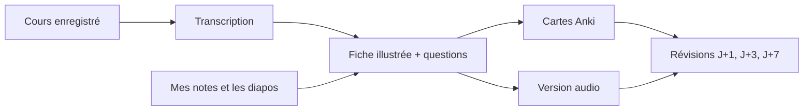

Salut ! Je suis en 1re année de médecine et l'IA me passionne, surtout ce qu'elle peut faire pour mieux apprendre sans y passer ses nuits.

J'utilise Claude tous les jours pour mes études. Mes cours sont enregistrés, Claude corrige la transcription, puis il en fait une fiche de révision illustrée avec des questions pour me tester. Il crée aussi mes cartes Anki et une version audio de chaque cours, que j'écoute en marchant. Le tout est planifié dans une app de révision que je construis avec Claude Code.

Au passage, j'ai fait quelques outils que je partage ici :

- [claude-explain-like-chatgpt](https://github.com/alxhe3-lab/claude-explain-like-chatgpt) : je trouvais les explications de Claude trop chargées par rapport à ChatGPT, alors j'ai écrit des skills pour qu'il explique comme une vraie fiche.
- [claude-inline-images](https://github.com/alxhe3-lab/claude-inline-images) : comment faire pour que Claude mette chaque image au bon endroit dans sa réponse, et pas toutes à la fin.
- [schemas-medecine](https://github.com/alxhe3-lab/schemas-medecine) : tous les schémas de mes fiches, en français, libres d'utilisation. Il y en a de nouveaux après chaque cours.
- [pont-claude-code](https://github.com/alxhe3-lab/pont-claude-code) : une extension pour que le chat Claude lance Claude Code lui-même, sans copier-coller entre les deux.
- [SymbolPill](https://github.com/alxhe3-lab/SymbolPill) : les symboles scientifiques (Ca²⁺, β, ×10⁻³…) à un clic dans la barre des menus du Mac.
- [EmojiPill](https://github.com/alxhe3-lab/EmojiPill) : pareil, pour mes emojis préférés.

Si tu fais un truc similaire pour tes études, n'hésite pas à ouvrir une issue, ça m'intéresse.

---

*Med student, into AI. I use Claude to turn my lectures into revision sheets, flashcards and audio, and I share the tools I build along the way.*
